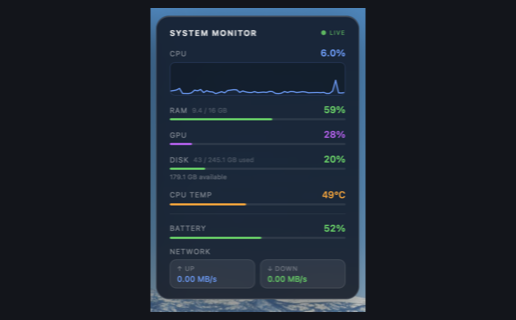

# System Monitor Widget for Übersicht

A dark, glassy system monitor widget for macOS Übersicht. Displays live CPU usage with an animated line graph, RAM, GPU, disk usage, CPU temperature, battery (with charging indicator) and network upload/download speed. Updates every 3 seconds.



## Features

- 📊 Live CPU usage with animated moving graph
- 💾 RAM usage with used / total GB
- 🎮 GPU usage percentage
- 🗄️ Disk usage of the macOS Data volume, with free space
- 🌡️ CPU temperature
- 🔋 Battery percentage with charging indicator
- 🌐 Network upload & download speed
- 🖱️ Draggable; the position is remembered across refreshes and restarts
- 🎨 Dark semi-transparent glass card design

## Requirements

- macOS with Apple Silicon (M1 / M2 / M3 / M4)
- [Übersicht](https://tracesof.net/uebersicht/) installed, with **Interaction** enabled for dragging
- [macmon](https://github.com/vladkens/macmon) for CPU temperature (no sudo required):

```bash
brew install macmon
```

## Installation

Symlink (or copy) this folder into Übersicht's widgets directory:

```bash
ln -s "$PWD" ~/Library/Application\ Support/Übersicht/widgets/system_monitor.widget
```

It appears in the top-left corner; drag it wherever you like.

## Configuration

Open `index.jsx` to adjust:

| Constant | Default | Description |
|---|---|---|
| `refreshFrequency` | `3000` | Poll interval in milliseconds |
| `MAX_HISTORY` | `60` | Number of CPU graph data points |
| `ACCENT / GREEN / ORANGE / RED / PURPLE` | — | Theme colors |

To reset a dragged position, remove the `system-monitor-widget-pos` key from Übersicht's
localStorage (or drag it back).

## How It Works

`stats.sh` runs on every refresh and outputs a single JSON object containing all metrics. It uses:

- `top` — CPU usage
- `vm_stat` — RAM usage
- `ioreg` — GPU utilization
- `df` — disk usage of the Data volume
- `macmon pipe` — CPU temperature (Apple Silicon, no sudo)
- `pmset` — battery status and charging state
- `netstat` — network throughput (two samples, ~1 second apart)

`index.jsx` parses the JSON and renders the UI using Übersicht's built-in JSX/React layer.

## License

MIT
